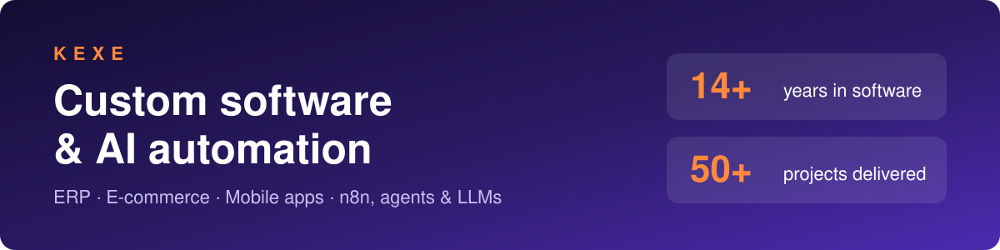
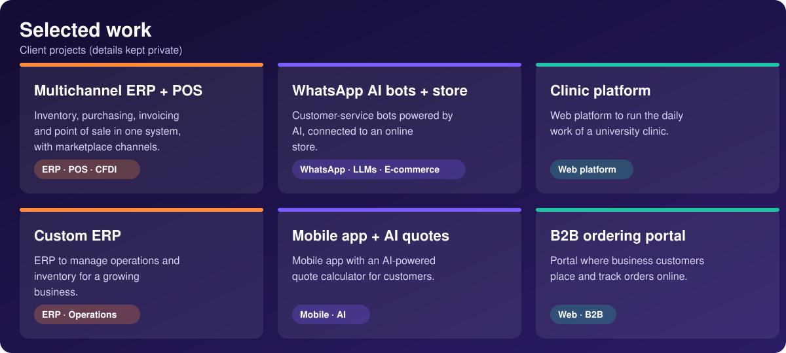

  

# Hi, I'm Alex 👋

Full-stack developer and founder of **Kexe**, a custom software studio in Guadalajara, Mexico.

I have 14+ years in software. I started as a developer, and today I build systems for small businesses and startups: 50+ projects delivered.

## What I do

- Custom software: ERP, portals, online stores and mobile apps
- AI automation: n8n, agents and LLMs, APIs and webhooks
- Dashboards and reports to make better decisions

## Selected work

  

Client projects are private for confidentiality. The cards above are short descriptions without client data.

## Tech stack

.NET · C# · Python · PHP / Laravel · JavaScript / React · Flutter / Dart · Azure · Docker

## Public projects

- [realtime-msg-signal-dotnet-react-sample](https://github.com/KexeMx/realtime-msg-signal-dotnet-react-sample): .NET 8 + React deployed on Google Cloud (Docker) vs a VPS, comparing performance, setup and cost
- [Manos-limpias](https://github.com/KexeMx/Manos-limpias): augmented reality web app that detects your hands with the camera
- [AgileMentor](https://github.com/KexeMx/AgileMentor): reference material for modern agile teams

## Work with me

Open to remote freelance projects. Languages: Spanish (native) and English (intermediate).

- Website: [kexe.mx](https://kexe.mx)
- LinkedIn: [alexramosal](https://www.linkedin.com/in/alexramosal)
